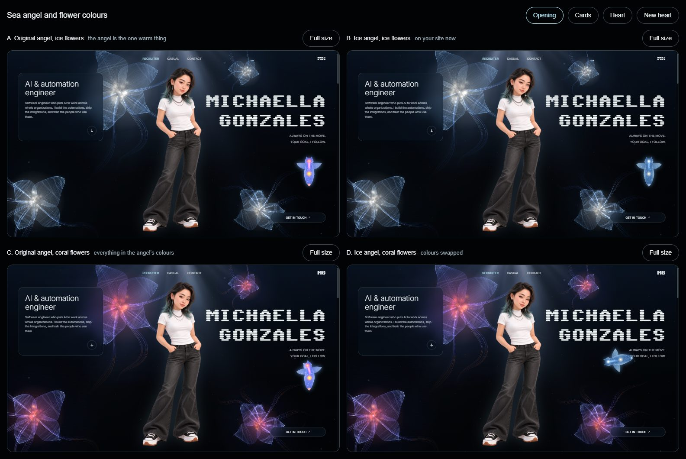
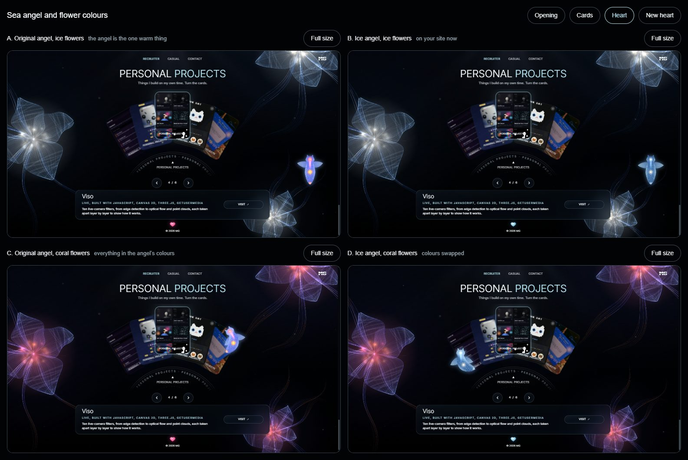

# Style options: sea angel and flower colours

**Status: settled on B, the complete ice theme, for now (25 November 2026).** The other options are kept, so we can come back to them.

Two things can change colour: the sea angel (with its heart) and the flowers drifting in the background. Each has two palettes:

- **Ice**: the site's own colours. Steel blue, pale ice, warm white light.
- **Coral**: the sea angel's first colours. Blue-violet, orange and pink.

The page, glass, text and layout are the same in all four.

## The options

| Option           | Angel and heart | Flowers | How to see it locally                           |
| ---------------- | --------------- | ------- | ----------------------------------------------- |
| A                | Coral           | Ice     | `localhost:5173/?angel=coral#top`               |
| **B (the site)** | **Ice**         | **Ice** | `localhost:5173/#top`                           |
| C                | Coral           | Coral   | `localhost:5173/?angel=coral&flowers=coral#top` |
| D                | Ice             | Coral   | `localhost:5173/?flowers=coral#top`             |

## Weighing them up

| Option | For                                                                                   | Against                                                                   |
| ------ | ------------------------------------------------------------------------------------- | ------------------------------------------------------------------------- |
| A      | The angel and the pink heart stand out: they are the only warm things on the page     | The angel can look like it comes from another site                        |
| B      | Calmest and most consistent. Closest to the reference. Nothing competes with the text | The angel blends in with the flowers, and the icy heart is harder to spot |
| C      | Richest and most playful. The angel and flowers look like one family                  | Furthest from the reference. The flowers pull attention from the text     |
| D      | The angel stands out as the one cool thing                                            | Same pull from the flowers as C, and it reverses the theme                |

## Still open

- **Pink heart in the ice theme.** The icy heart is easy to miss. A pink one would be the only warm colour on the page. Not built.
- **Softer coral flowers** for C or D, so they compete less with the text. Not built.
- **Text contrast with coral flowers** has not been measured. With ice flowers, body text is at least 5.0:1 on every screen measured (the target is 4.5:1). Measure before choosing C or D.

## Where it lives

- The comparison page is `compare.html`. Run `npm run dev` and open `localhost:5173/compare.html`: all four run live, side by side. Nothing on the site links to it, and `npm run build` leaves it out.
- The `?angel=` and `?flowers=` switches work only in `npm run dev`. Visitors always get the default.
- Angel palettes: `CORAL` and `ICE` in `src/lib/angel.ts`. The default is set in `palette()` in `src/components/effects/CursorAngel.tsx`.
- Flower palettes: `CORAL` and `ICE` in `src/lib/bloom.ts`. The default is set in `palette()` in `src/components/effects/Ocean.tsx`.

To change the choice, change the default in those two `palette()` functions, then update the table above and the labels in `compare.html`.
